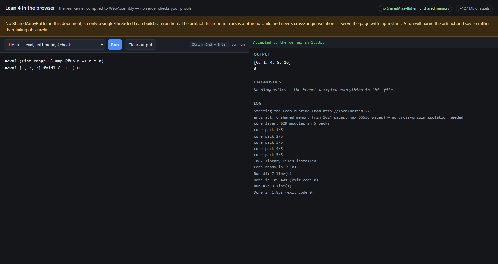

# Build a single-threaded Lean wasm

This builds the artifact that removes the cross-origin isolation requirement entirely, instead of living
with it or working around it. `FINDINGS.md` §9 is the analysis; this directory is the machinery, and
§9.1–§9.3 should be read first, because **the flags are the easy part and the build will not work
without the runtime change.**

What it produces: `lean.js`, `lean.wasm` and the `.olean` tree for `wasm32`, whose memory import is
`flags 1` — unshared — instead of `flags 3` — `has-max | shared`. An unshared memory needs no
`SharedArrayBuffer`, so a page needs no COOP/COEP, no `Document-Isolation-Policy` and no origin trial,
and works in every browser rather than only Chrome. The runtime in this repo already handles that
artifact: it reads the mode off the wasm before booting
([`packages/lean-wasm/src/artifact-probe.js`](../packages/lean-wasm/src/artifact-probe.js)), so it needs
no changes to consume what this builds.



The run above is the whole point, in one screenshot: `crossOriginIsolated: false`, no
`SharedArrayBuffer` anywhere, the pill reading **no SharedArrayBuffer · unshared memory**, and a proof the
kernel accepted. The log tells the rest — the artifact declares an unshared memory, the 629-module core
layer arrives in 5 packs, 1,887 files are installed, and then two compiles: **109.4 s cold** (the `Init`
import on one thread) and **1.83 s warm** (the environment is reused).

## Status: it builds, and it runs Lean

**The artifact exists and works.** `docker run … 2` produces a `lean.wasm` that declares
`flags=1, shared=false`, and the demo in this repo accepts proofs on it in a document with no isolation at
all — measured in headless Chrome 155, page and assets on different origins (`FINDINGS.md` §9.7). Both
blockers the fork's source names as needing upstream work are answered by
`patches/0002-sequential-task-manager.patch`, in the smallest form they can be: keep `-D LEAN_MULTI_THREAD`,
create the manager with zero workers so `g_task_manager` is never null, and let `wait_for`/`wait_any` drain
the task queue on the thread that is waiting. The waiter becomes the worker, which is also what stops the
async-const realization accumulating — one change, both blockers.

Four traps were found by building rather than reading, and all four are fixed here with the reasoning
recorded: the CMake 4 pin, the emsdk `EMSDK_NODE` path, the `-DUSE_MIMALLOC=OFF` the CI passes and
`docker-wasm/` does not, and — the expensive one — the bind-mounted work tree whose inode numbers do not fit
in 32 bits (`## What the fork's own Docker recipe gets wrong`, below).

Two things about the result are worth keeping in view rather than buried:

- **The first compile is slow: 109 s in the screenshot, 54 s in an earlier run.** Boot is *faster* than the
  pthread build (3.4–19 s against 5.1–5.8 s, with no worker pool to pre-spawn), but the first `Run` pays the
  `Init` import on a single thread. Warm compiles are ~1.8 s.
- **The atomic-instruction question is unresolved.** `verify-memory.mjs` reports a 30× fall in
  atomic-prefix bytes (429,614 → 14,390) and is explicit that this is evidence, not proof — and V8 does not
  enforce the spec rule either way, so Chrome accepting the module proves nothing. Firefox and Safari
  remain the check.

## Prerequisites

- Docker, with ~15 GB of free disk and 8 GB+ of RAM. The fork's own note: the first build takes 30–60
  minutes, incremental relinks are minutes.
- Network access for the fork clone (~1 GB) and the emsdk download.

## Running it

```bash
cd wasm-build
docker build -t lean4-wasm-single-threaded .

# Variant 1: the flags only. This is expected to FAIL, and how it fails is the point.
docker run --rm -v lean-build-cache:/cache -v "$PWD/out:/out" lean4-wasm-single-threaded 1

# Variant 2: flags plus the sequential task manager. This is the one that should work.
docker run --rm -v lean-build-cache:/cache -v "$PWD/out:/out" lean4-wasm-single-threaded 2
```

On Windows, the `out` bind mount wants an absolute path and `--mount` if the drive letter confuses the
parser — and **`cache` must be a named volume, not a bind mount**:

```powershell
docker run --rm -v lean-build-cache:/cache `
              --mount type=bind,source=D:/repo/wasm-build/out,target=/out `
              lean4-wasm-single-threaded 2
```

**`cache` must be a Docker volume — this is not a preference.** It holds the pinned fork and the cmake
build tree, and on Docker Desktop a bind mount from the host filesystem hands out inode numbers that do
not fit in 32 bits:

```
bind mount (Windows):     inode=4503599631510846   ← does not fit in 32 bits
named volume (VM ext4):   inode=1696160            ← does
```

stage0 is a **native 32-bit** binary by design, so every `stat()` it makes on the bind mount returns
`EOVERFLOW`, and the build dies in stage1 with

```
error: Init/MethodSpecsSimp.lean:7:0: failed to stat file '…/Init/Prelude.olean':
       Value too large for defined data type
```

which reads like a corrupt object file and is an inode number. The fork's own instructions tell you to
bind-mount the source (`docker run -v "$(pwd):/lean4" …`), which is correct on native Linux and breaks
exactly here.

Resuming is cheap: everything lives on the volume, and `build.sh` skips re-applying the patches when the
tree already carries them (re-applying rewrites those files, and `make` answers by rebuilding stage0 —
tens of minutes to change nothing). Use `-e RESET=1` when you want a clean tree, which switching variants
needs. For a relink after a change to patch 0002, add `-e MAKE_TARGET=lean`.

Each variant gets its own build directory (`build/wasm-1`, `build/wasm-2`), so switching between them does
not reconfigure a tree the other one built. `-e EMSCRIPTEN_DEBUG=ON` adds a name section and assertions,
which is worth the extra build when a wasm trap needs symbolising.

Artifacts land in `out/<variant>/` — `lean.js`, `lean.wasm`, `olean/`, the resolved `LEAN_COMMIT`, and
`applied.patch` (what the build actually applied, for provenance). Each run ends by telling you to read
the memory import out of the wasm it just built, using the runtime's own parser, so the first thing you
look at is either `unshared` or a statement of why the artifact is not what was asked for.

## Variant 1: the flags only — expected to fail, and why that is useful

`patches/0001-cmake-single-threaded.patch` removes `-pthread`, `-sPTHREAD_POOL_SIZE=4` and friends. It is
mechanical, and on its own it produces exactly the failure the fork's CMake describes (l.201–204):

> 4.33's import machinery creates IO.Promises during env realization, and without LEAN_MULTI_THREAD the
> task manager is a no-op, so Promise.new panics by design. A single-thread (no COOP/COEP, phone-sized)
> build needs a sequential task manager upstream first.

The mechanism, from `src/runtime/object.cpp`: `lean_init_task_manager_using` is entirely inside
`#if defined(LEAN_MULTI_THREAD)`, so with the macro off there is no manager at all, and
`lean_promise_new` (l.1281) panics "by design" rather than return something that can never be resolved.
Six more promise/IO paths dereference `g_task_manager` unchecked.

The second blocker is the one that decides whether the route is shippable (l.176–180):

> The single-threaded WASM build OOMs during the `Init` olean import (upstream's async-const realization
> accumulates unboundedly with no worker threads to drain it); the pthread build — like the native and
> the older 4.28 WASM builds — drains that work on real worker threads.

Run variant 1 to find out which of these you hit first, and how. That is the measurement this directory
cannot hand you.

## Variant 2: the flags plus a sequential task manager

`patches/0002-sequential-task-manager.patch` is the part that needs the build loop to converge. Its
design is deliberately the *smallest* change that can work, and it differs from the direction the fork's
comment implies — worth knowing before choosing:

Both variants drop `-pthread`, which is what produces the unshared memory. They differ in whether they
also drop `-D LEAN_MULTI_THREAD`:

| | `-D LEAN_MULTI_THREAD` | what then has to change |
| --- | --- | --- |
| the fork's suggestion | dropped | the promise and IO paths, which are compiled in either way but assume a manager — a sequential manager, or null-handling at seven call sites |
| **what this patch does** | **kept** | only `task_manager` in `src/runtime/object.cpp` |

Keeping the macro is smaller and it sidesteps the panic rather than working around it: with the macro on,
the manager *exists*, so `lean_promise_new`, `resolve`, `wait_any`, `get_task_state` and `cancel` all have
something to talk to, and no call site needs an `#ifdef`. The change is:

1. Create the manager with zero workers instead of skipping it, so `g_task_manager` is never null.
2. **Drain on wait.** With no workers, nothing retires a queued task, so `wait_for` and `wait_any` must
   run the queue themselves rather than sleep on a condition variable that nothing will signal. This is
   the "sequential task manager": the waiter becomes the worker.
3. Set `g_current_task_object` while draining, so a nested `wait_for` inside a drained task behaves the
   way the existing `in_pool` logic expects.

Item 2 is also the answer to the OOM blocker: the async-const realization is drained *by the import loop
that is waiting on it*, instead of queueing faster than one thread can retire it.

The risk to watch: `wait_for` contains a guard for `(sync := true)` tasks — "`Task.get` called from a
`(sync := true)` task" — which exists to catch a deadlock in the threaded runtime. In a single-threaded
runtime every wait is effectively synchronous, so that guard's intent has to be preserved while its
trigger is re-examined; if `Init` import trips it, that is the line to look at. The patch keeps the guard
and adds the drain ahead of it, which is the conservative choice.

## What it had to satisfy — and where each one landed

1. **It builds, and declares an unshared memory.** Met: `verify-memory.mjs` on the built 97.52 MiB artifact
   reports `memory: defined`, `shared: false`, `verdict: unshared`, min 1024 / max 65536.
2. **No atomic instructions.** **Open.** Removing `-pthread` should be what guarantees it, and the prefix
   count falls 30×, but that is not proof and V8 does not enforce the rule — see the status note above. A
   conformant engine is the check.
3. **It runs the §4 table with no isolation.** Met: `crossOriginIsolated === false`,
   `typeof SharedArrayBuffer === 'undefined'`, a proof accepted (`exitCode 0`), and library `#eval` working
   — `#eval (List.range 5).map (fun n => n * n)` printing `[0, 1, 4, 9, 16]`, which only works because the
   packed layer carries `.ir` beside `.olean`.
4. **It matches the pinned build's shape.** Met for the layer — the `Init` closure packs to the same 629
   modules / 1,887 files / 76.1 MB raw / 5 packs / 30.7 MB as upstream ships. **Not yet done** for the rest:
   the `Std`/`Lean`/`Batteries` trees and the Mathlib layer the demo's other examples use have not been
   packed from this build, so those examples would need their own mirrors.

## Serving what it built

The build writes `lean.js`, `lean.wasm` and the `olean/` tree into `out/<variant>/`. To run the demo on it —
which is what the screenshot above is:

```bash
# pack the Init closure into the layer the runtime boots from (629 modules, 5 packs, ~31 MB)
node wasm-build/pack-core-layer.mjs wasm-build/out/variant-2/olean wasm-build/out/mirror/lean-wasm Init
cp wasm-build/out/variant-2/lean.js wasm-build/out/variant-2/lean.wasm wasm-build/out/mirror/lean-wasm/

# two servers: the page with NO isolation headers, and the assets it fetches
node serve.js 8129 public --no-isolation
node serve.js 8127 wasm-build/out/mirror

# → http://localhost:8129/?baseUrl=http://localhost:8127
```

The page and the assets are on **different origins on purpose**: that is the shape a LiveCodes result page
has, and it is the case the CORS and CORP headers exist for. `?baseUrl=` is the only configuration needed —
the runtime reads the requirement off the wasm before it boots — and the outcome is in the log: the artifact
declares an unshared memory, the core layer arrives in 5 packs, and the first compile pays the `Init` import.
Expect that first Run to take a minute or two.

`pack-core-layer.mjs` is also how the tree packs at all: it is upstream's job in the deployed pipeline
(`scripts/package-core-layer.mjs` in `cauli/lean4-wasm-in-browser`), and without it a fresh build has no
layer and the runtime cannot boot — it fetches `core-layer.json` unconditionally.

## What the fork's own Docker recipe gets wrong

`docker-wasm/` in `cauli/lean4` is the obvious place to start and it is stale in four ways, all found by
building rather than reading. The Dockerfile and build.sh here are adapted from it with these fixed, and
each is worth knowing before trusting anything else in it:

1. **`cmake>=3.28` now installs CMake 4.x**, and under CMake 4 this build compiles *stage0* with the
   Emscripten toolchain instead of the native 32-bit clang that `-DSTAGE0_CMAKE_CXX_COMPILER=clang++`
   asks for. It fails a few seconds into `make stage1` with
   `em++: error: passing any of -msse2 ... requires passing -msimd128` — the stage0 flags are native-x86
   flags, and they are being handed to a wasm compiler. Pinned to `<4` here.
2. **`EMSDK_NODE` is pinned to a Node version that no longer exists.** The Dockerfile hardcodes
   `node/20.18.0_64bit/bin/node`; emsdk 4.0.22 now fetches 24.19.0, and `emcc` prefers `EMSDK_NODE` over
   `node` on `PATH` when it is set — so the pin points at nothing. Removed here; `emsdk_env.sh` sets it
   correctly and `build.sh` sources that.
3. **Its build.sh prints "single-threaded; no lean.worker.js"** while its README documents `-pthread`
   with `PTHREAD_POOL_SIZE=4` — and the deployed artifacts have the worker pool. The comment is wrong;
   the README is right. That is a small thing to be wrong about, but it is the one thing this directory
   is *about*, so it is worth not trusting.
4. **`-DUSE_MIMALLOC=OFF` is in the CI but not in that build.sh**, so it configures and builds mimalloc
   for wasm — which `src/CMakeLists.txt` says cannot work under Emscripten ("mimalloc's OS layer can't
   grow memory under Emscripten"). Passed here, matching the CI.
5. **Its README tells you to bind-mount the source** (`docker run -v "$(pwd):/lean4" …`). Correct on
   native Linux, broken on Docker Desktop: the host filesystem's inode numbers do not fit in 32 bits and
   stage0 *is* a 32-bit binary, so its `stat()` calls return `EOVERFLOW` — see `## Running it` for the
   volume that fixes it and the exact misleading error it produces.

The authoritative reference is the CI, not `docker-wasm/`: `.github/workflows/ci.yml` has the wasm job's
`CMAKE_OPTIONS`, and `build-template.yml` has its emsdk version (4.0.22) and the `--preset release` the
job configures with. Where this harness and `docker-wasm/` disagree, the CI wins — and where the CI and
the two of them disagree about whether the result is pthread-linked, the artifact does.

## Files

```
Dockerfile                              emsdk 4.0.22, 32-bit stage0, cmake >= 3.28, < 4 — see above
build.sh                                clone the fork at the pinned commit, patch, configure, build, report
patches/0001-cmake-single-threaded.patch     the flags
patches/0002-sequential-task-manager.patch   the runtime change that makes the flags work
verify-memory.mjs                       reads the memory off a built wasm, using the package's parser
pack-core-layer.mjs                     packs a build's library tree into the layer the runtime boots from
single-threaded-run.png                 a proof accepted with no cross-origin isolation
```

Pinned: `cauli/lean4` @ `reinstate-wasm` `dfe49531687435bcb38516a73a7c7ff55e3ef25e` (2026-09-06). The
`.olean` files it produces are only compatible with this same build, which is the pairing `FINDINGS.md`
§5 records — do not mix them with the pthread artifacts.
